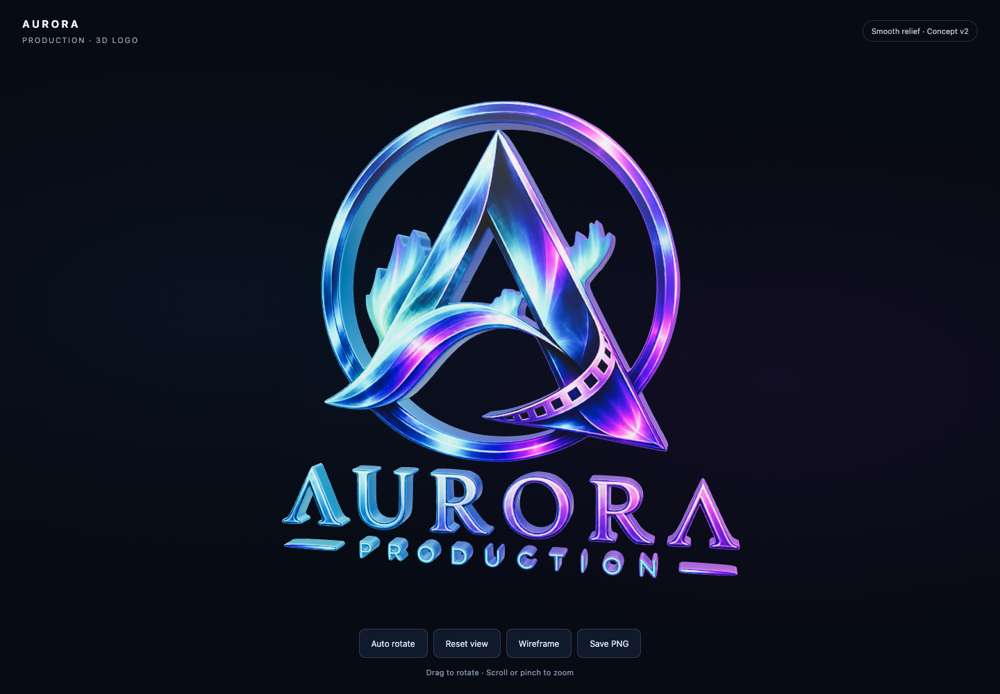

# Aurora Production — interactive 3D logo

[Open the live HTML viewer](https://jalalhussein1982.github.io/aurora/)

A local 3D relief of the Aurora Production concept artwork, rendered with Three.js. The ring and lettering use smooth fitted curves, rounded bevels, and cyan-to-violet metallic sides.



## View and interact

Open the published site, or download `index.html` and open it directly in a modern browser. The HTML embeds the model, textures, and Three.js, so it also works offline.

- Drag to rotate; scroll or pinch to zoom.
- Use **Auto rotate**, **Reset view**, or **Wireframe** to inspect the model.
- Use **Save PNG** to download a transparent image of the current view.
- With the canvas focused, arrow keys rotate, + / − zoom, and Home resets the view.

## Project files

| Path | Contents |
| --- | --- |
| `index.html` | Complete standalone viewer and GitHub Pages homepage |
| `meshy_output/aurora-logo-relief.glb` | Portable 3D model with embedded texture |
| `meshy_output/aurora-logo-relief.three.json` | Native Three.js ObjectLoader model |
| `meshy_output/viewer-source/` | Viewer, model generation, vector outlines, and checks |
| `output/brand/working/aurora-logo-generated-cutout-not-approved.png` | Preserved reference artwork |
| `meshy_output/verification.json` | Offline browser verification results |
| `meshy_output/model-verification.json` | Model reload and geometry attribute checks |

The model contains 19 components, 12 openings, and 119,980 triangles. Its outlines use 357 fitted cubic Bézier segments from the original 1254 × 1254 reference. This remains a concept based on the selected artwork.

## Rebuild the viewer

Use Node.js with npm. From the repository root:

```sh
npm ci --prefix meshy_output/viewer-source
node meshy_output/viewer-source/build.mjs
```

This rebuilds `index.html` using the checked-in GLB. It needs no account or external generation service.

To regenerate the model, also install Pillow for Python and Playwright for Node, with Google Chrome available. `PLAYWRIGHT_MODULE` may point to an existing Playwright ES module.

```sh
python3 -m pip install Pillow
npm install --prefix meshy_output/viewer-source --no-save playwright
python3 meshy_output/viewer-source/trace_logo.py
node meshy_output/viewer-source/trace-curves.mjs
node meshy_output/viewer-source/smooth-normals.test.mjs
node meshy_output/viewer-source/generate.mjs
node meshy_output/viewer-source/build.mjs
node meshy_output/viewer-source/verify.mjs
```

Potrace is a build dependency for fitting vector curves; it is not included in the browser bundle. Three.js 0.180.0 is included under the MIT license; see [third-party notices](THIRD_PARTY_NOTICES.txt).

## Publishing

GitHub Pages serves `main` from the repository root. The `.nojekyll` file enables static HTML publishing. After changing the viewer, rebuild and commit `index.html` with the related source and model files.
